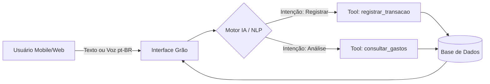

# 🌾 Grão: Assistente Financeiro Conversacional orquestrado por IA

> O Grão não é apenas uma interface; é um assistente financeiro inteligente que elimina a fricção das planilhas através de orquestração de IA, processamento de linguagem natural (NLP) e Design Universal.

<!-- Badges de Impacto -->
[](#)
[](#)
[](#)

---

## 📋 Índice

- [Visão do Produto e Impacto](#-visão-do-produto-e-impacto)
- [Arquitetura e Capacidades de IA](#-arquitetura-e-capacidades-de-ia)
- [Demonstração (E2E)](#-demonstração-e2e)
- [O "Código-Fonte" (PRD e Prompting)](#-o-código-fonte-prd-e-prompting)
- [Tecnologias Utilizadas](#-tecnologias-utilizadas)
- [Instalação e Execução](#-instalação-e-execução)
- [Próximos Passos (Roadmap)](#-próximos-passos-roadmap)

---

## 💡 Visão do Produto e Impacto

**O Problema:** A principal causa de *churn* (abandono) em apps de finanças é a carga cognitiva. Usuários odeiam preencher formulários com 5 a 10 campos para registrar um simples café.

**A Solução:** Tornar a gestão financeira tão simples quanto mandar uma mensagem de áudio ou texto. Construído com a premissa de *Design Universal*, o Grão permite que qualquer pessoa registre, audite e planeje sua vida financeira conversando, transformando linguagem natural em dados estruturados em milissegundos.

---

## 🧠 Arquitetura e Capacidades de IA

Para demonstrar domínio em Engenharia de IA aplicada a Produtos, o motor do Grão foi estruturado sobre três pilares técnicos:

1. **Orquestração NLP e Tool Calling:** O LLM atua como raciocínio central. Ele faz o *parsing* da entrada não-estruturada ("Gastei 120 de luz") e aciona ferramentas internas extraindo entidades rigorosas: `{"tipo": "despesa", "valor": 120.0, "categoria": "moradia"}`.
2. **Contexto Analítico (Zero Alucinação):** Implementação de ferramentas de consulta (`consultar_gastos`) que permitem à IA consultar diretamente o banco filtrando por período e categoria, fornecendo respostas exatas.
3. **Acessibilidade Nativa:** Integração com `Web Speech API` para transcrição de voz em tempo real no client-side (*hands-free*).

### 📐 Fluxo Arquitetural



---

## 💻 Demonstração (E2E)


---

## 📄 O "Código-Fonte" (PRD e Prompting)

O desenvolvimento deste projeto foi guiado pelo seguinte **Product Requirements Document (PRD)**, utilizado como contexto base para a geração da aplicação (Vibe Coding):

### 1. Visão Geral

Criar um aplicativo de finanças pessoais que permita ao usuário registrar, consultar e acompanhar sua vida financeira por meio de conversas em linguagem natural, eliminando a complexidade de planilhas e aplicativos tradicionais. O produto deve atuar como um assistente financeiro pessoal, ajudando usuários iniciantes a entenderem melhor seus hábitos financeiros, economizarem dinheiro e alcançarem metas financeiras.

### 2. O Problema

Muitas pessoas desistem de controlar suas finanças porque:

* Precisam preencher formulários manualmente.
* Não sabem categorizar despesas corretamente.
* Consideram relatórios financeiros difíceis de entender.
* Recebem pouca orientação personalizada.
* Perdem a motivação após alguns dias de uso.

*Consequência:* Perdem visibilidade sobre seus gastos e têm dificuldade em atingir objetivos financeiros.

### 3. Público-Alvo

* **Público Primário:** Pessoas iniciantes em educação financeira e organização pessoal.
* **Público Secundário:** Usuários que abandonaram apps tradicionais, pessoas que não gostam de planilhas, usuários com pouco conhecimento financeiro e pessoas que desejam criar o hábito de acompanhar gastos.

### 4. Proposta de Valor e Objetivo

Tornar a gestão financeira simples, intuitiva e acessível. O usuário deve conseguir registrar movimentações da mesma forma que conversa com uma pessoa. O aplicativo oferece:

* Registro de gastos por conversa com categorização automática.
* Acompanhamento de metas financeiras.
* Recomendações personalizadas e relatórios simples.
* Orientação contínua através de um agente financeiro virtual.

### 5. Funcionalidades do MVP

* **Chat Financeiro:** Permite registrar receitas e despesas. O sistema identifica *Valor, Tipo da transação, Categoria e Data*.
* *Ex:* Usuário: "Gastei R$ 45 no almoço hoje." -> Sistema: "Registrei uma despesa de R$ 45 na categoria Alimentação."


* **Categorização Automática:** Classificação (Alimentação, Transporte, Moradia, Saúde, Educação, Lazer, Salário, Outros). *Meta: >80% de precisão automática.*
* **Metas Financeiras:** Criação de objetivos (Reserva de emergência, Viagem) com Nome, Valor, Prazo e Progresso.
* **Agente Financeiro:** Análises e recomendações de hábitos (Ex: "Você gastou 18% a mais com delivery este mês.").
* **Dashboard Simplificado:** Indicadores de receitas, despesas, saldo atual, maiores gastos e evolução.

### 6. Design Universal e Acessibilidade

Garantir boa experiência independentemente de idade, limitações visuais/motoras ou cognitivas.

* **Usabilidade:** Linguagem simples, alto contraste, ícones textuais, botões amplos.
* **Inclusão Cognitiva:** Evitar excesso de informações; guiar o usuário em tarefas importantes.

### 7. Requisitos Não Funcionais

* **Performance:** Respostas do chat em até 3 segundos.
* **Segurança:** Dados criptografados e conformidade com LGPD.
* **Responsividade:** Abordagem Mobile-first.

### 8. Métricas e Validação do MVP

* **Validação Inicial:** Teste com 10 a 20 usuários (Hipótese: Usuários preferem chat a formulários).
* **Critérios de Sucesso:**
* Pelo menos 70% dos usuários conseguirem registrar sem ajuda.
* Pelo menos 50% de retenção no D7 (após 7 dias).
* Categorização automática atingir >80% de acerto.
* Maioria considerar o chat mais simples que planilhas.


---

## 🛠 Tecnologias Utilizadas

* **Frontend:** React, Tailwind CSS, Shadcn UI
* **Backend & Banco de Dados:** Supabase
* **IA e NLP:** Integração com LLMs via API (Function Calling)
* **Geração de Código:** Lovable (Vibe Coding)

---

## 🚀 Instalação e Execução

Para rodar este projeto localmente:

1. Clone o repositório:

```bash
git clone [https://github.com/PedroHenrique158/grao-assistente-financeiro.git](https://github.com/PedroHenrique158/grao-assistente-financeiro.git)

```

2. Instale as dependências:

```bash
npm install

```

3. Inicie o servidor de desenvolvimento:

```bash
npm run dev

```

---

## 🗺 Próximos Passos (Roadmap)

* [ ] Implementar gráficos interativos com evolução mensal no Dashboard.
* [ ] Adicionar suporte a múltiplos idiomas e moedas.
* [ ] Conexão direta com APIs bancárias (Open Finance) para leitura de saldos.

```

```
