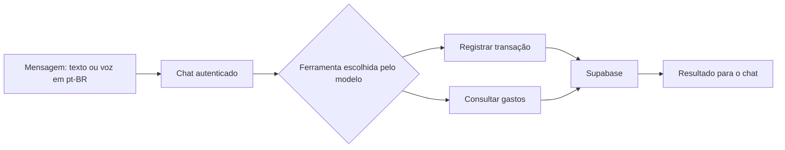

# 🌾 Grão

O Grão é um protótipo para registrar e consultar despesas por conversa. A ideia é trocar o formulário por uma frase, como “Gastei R$ 45 no almoço”. Escrevi os requisitos do produto e usei o Lovable para prototipar o fluxo com TypeScript e Supabase.

## Veja a ideia em prática

Depois do login, a pessoa pode digitar uma despesa ou ditá-la em um navegador compatível. O chat interpreta a mensagem e chama uma ferramenta de registro. Em seguida, perguntas como “Quanto gastei com alimentação este mês?” usam os lançamentos guardados na conta para compor a resposta.


A imagem mostra a interface do protótipo. Não é um relatório de teste de ponta a ponta.

## Como funciona



- **Interface:** React, TypeScript e TanStack Start. A entrada por voz usa reconhecimento de fala do navegador; o texto continua disponível sem microfone.
- **Chat:** a aplicação valida a sessão, chama o gateway de IA do Lovable no servidor e usa ferramentas como `registrar_transacao` e `consultar_gastos`.
- **Dados:** Supabase Auth e PostgreSQL. A migração versionada define políticas de acesso por usuário (RLS). As consultas usam dados registrados, mas a interpretação da pergunta e a redação da resposta ainda podem falhar.

## Como rodar

Você vai precisar de [Bun](https://bun.sh/), de um projeto Supabase de desenvolvimento e, para usar o chat, de acesso ao gateway de IA do Lovable.

```bash
git clone https://github.com/PedroHenrique158/grao-assistente-financeiro.git
cd grao-assistente-financeiro
bun install --frozen-lockfile
```

1. Use `.env.example` como referência para configurar a URL e a chave **publicável** do seu próprio projeto Supabase nas variáveis do servidor (`SUPABASE_*`) e do cliente (`VITE_SUPABASE_*`). Não use a instância publicada como banco de desenvolvimento.
2. Aplique em seu projeto de desenvolvimento a migração em `drizzle/migrations/0000_migration.sql` e configure o Supabase Auth.
3. Para o chat, disponibilize `LOVABLE_API_KEY` apenas ao processo do servidor. Não use prefixo `VITE_` para essa credencial e não a envie ao Git.
4. Rode `bun run dev` e abra o endereço exibido pelo terminal.

## Testes

```bash
bun run test
```

O repositório inclui testes de cálculo de saldo, progresso de metas, filtros de despesas e da rota inicial. Esses testes não substituem a validação do fluxo completo com Supabase e o gateway de IA.

## Requisitos do produto (PRD)

O documento abaixo orientou a prototipagem. Os percentuais, tempos de resposta, requisitos de segurança e critérios de adoção são **metas de projeto**, não resultados medidos, certificações ou comprovação de conformidade.

<details>
<summary>Ler o PRD original</summary>

### 1. Visão Geral

Criar um aplicativo de finanças pessoais que permita ao usuário registrar, consultar e acompanhar sua vida financeira por meio de conversas em linguagem natural, eliminando a complexidade de planilhas e aplicativos tradicionais. O produto deve atuar como um assistente financeiro pessoal, ajudando usuários iniciantes a entenderem melhor seus hábitos financeiros, economizarem dinheiro e alcançarem metas financeiras.

### 2. O Problema

Muitas pessoas desistem de controlar suas finanças porque:

* Precisam preencher formulários manualmente.
* Não sabem categorizar despesas corretamente.
* Consideram relatórios financeiros difíceis de entender.
* Recebem pouca orientação personalizada.
* Perdem a motivação após alguns dias de uso.

*Consequência:* Perdem visibilidade sobre seus gastos e têm dificuldade em atingir objetivos financeiros.

### 3. Público-Alvo

* **Público Primário:** Pessoas iniciantes em educação financeira e organização pessoal.
* **Público Secundário:** Usuários que abandonaram apps tradicionais, pessoas que não gostam de planilhas, usuários com pouco conhecimento financeiro e pessoas que desejam criar o hábito de acompanhar gastos.

### 4. Proposta de Valor e Objetivo

Tornar a gestão financeira simples, intuitiva e acessível. O usuário deve conseguir registrar movimentações da mesma forma que conversa com uma pessoa. O aplicativo oferece:

* Registro de gastos por conversa com categorização automática.
* Acompanhamento de metas financeiras.
* Recomendações personalizadas e relatórios simples.
* Orientação contínua através de um agente financeiro virtual.

### 5. Funcionalidades do MVP

* **Chat Financeiro:** Permite registrar receitas e despesas. O sistema identifica *Valor, Tipo da transação, Categoria e Data*.
* *Ex:* Usuário: "Gastei R$ 45 no almoço hoje." -> Sistema: "Registrei uma despesa de R$ 45 na categoria Alimentação."


* **Categorização Automática:** Classificação (Alimentação, Transporte, Moradia, Saúde, Educação, Lazer, Salário, Outros). *Meta: >80% de precisão automática.*
* **Metas Financeiras:** Criação de objetivos (Reserva de emergência, Viagem) com Nome, Valor, Prazo e Progresso.
* **Agente Financeiro:** Análises e recomendações de hábitos (Ex: "Você gastou 18% a mais com delivery este mês.").
* **Dashboard Simplificado:** Indicadores de receitas, despesas, saldo atual, maiores gastos e evolução.

### 6. Design Universal e Acessibilidade

Garantir boa experiência independentemente de idade, limitações visuais/motoras ou cognitivas.

* **Usabilidade:** Linguagem simples, alto contraste, ícones textuais, botões amplos.
* **Inclusão Cognitiva:** Evitar excesso de informações; guiar o usuário em tarefas importantes.

### 7. Requisitos Não Funcionais

* **Performance:** Respostas do chat em até 3 segundos.
* **Segurança:** Dados criptografados e conformidade com LGPD.
* **Responsividade:** Abordagem Mobile-first.

### 8. Métricas e Validação do MVP

* **Validação Inicial:** Teste com 10 a 20 usuários (Hipótese: Usuários preferem chat a formulários).
* **Critérios de Sucesso:**
* Pelo menos 70% dos usuários conseguirem registrar sem ajuda.
* Pelo menos 50% de retenção no D7 (após 7 dias).
* Categorização automática atingir >80% de acerto.
* Maioria considerar o chat mais simples que planilhas.

</details>

## Próximos passos

- Mostrar o valor e a categoria para confirmação antes de salvar um lançamento interpretado pelo chat.
- Evoluir os gráficos de acompanhamento mensal.
- Avaliar suporte a múltiplos idiomas e moedas.
